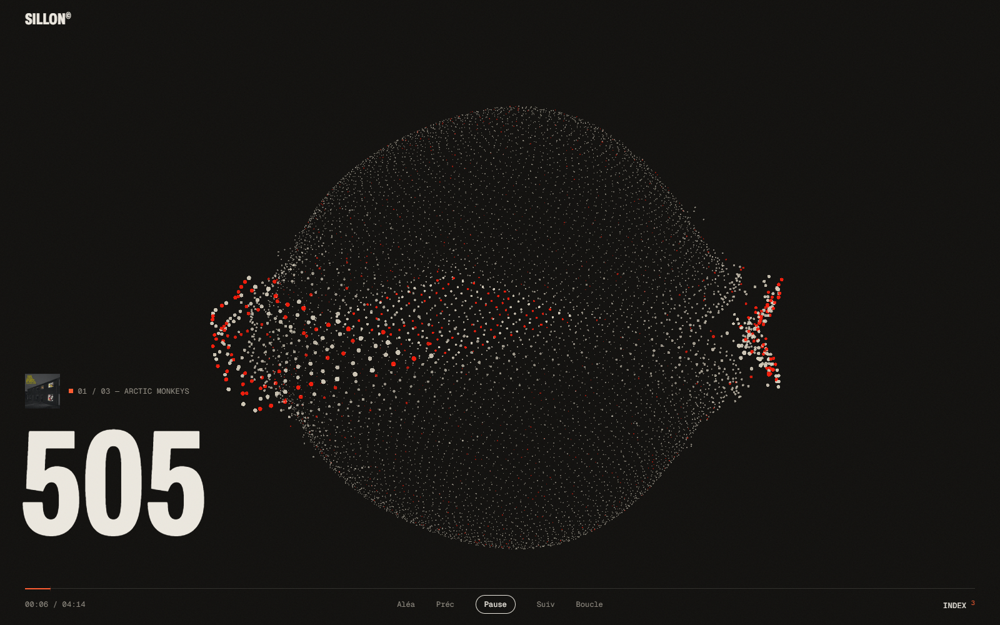
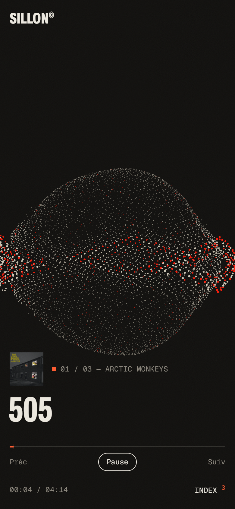

# Sillon

Lecteur de musique perso : un **serveur** qui garde mes sons, un écran **ultra minimaliste** avec un visualiseur 3D qui danse dessus.





```bash
npm install                      # GSAP (servi au client)
npm run import -- "chemin/vers/mes/sons"
npm start                        # http://localhost:4173
```
Node ≥ 22.13 (SQLite intégré). La musique (`music/`) et la base (`data/`) ne sont pas versionnées.

## Base de données (SQLite, `data/sillon.db`)
Toute la bibliothèque vit dans la base : titre, artiste, album, genre, année, pochette, durée, écoutes,
et pour chaque son la **suite de vues du visualiseur** (`visual`, ex. `sphere,anneau,spectre`) et leur durée (`visual_every`, en secondes).
SQLite est intégré à Node (≥ 22.13), aucune dépendance.

```bash
npm run import -- "C:\cheminers\dossier"   # copie sons + pochettes dans music/ et les inscrit
npm run db                                      # liste
npm run db -- set 2 artist="Panchiko" genre=Indie
npm run db -- set 1 visual=spectre,anneau visual_every=16
```
Pochette = image du même nom que le son (l'import l'associe tout seul : `505.jpg` → `505 - Arctic Monkeys.mp3`).

## Client (`public/`, vanilla + Three.js + GSAP, sans build)
Un seul écran, dans le style du portfolio : titre en cours en grosse typo condensée, visualiseur 3D de particules
qui réagit au spectre (trois vues : sphère, spectre qui défile, anneau ; elles s'enchaînent toutes seules selon la base, et plus tôt sur une montée de basses), barre de progression fine, index des sons,
glisser-déposer pour envoyer des fichiers au serveur.

Raccourcis : `Espace` lecture · `←/→` ±5 s · `Maj+←/→` son précédent/suivant · `I` index · `Échap` fermer.

## Héberger
Il faut un hébergeur qui fait tourner **Node** et garde des fichiers (pas GitHub Pages, qui ne sert que du statique) :
un VPS, un Raspberry Pi à la maison, ou Railway / Render / Fly.io avec un disque persistant monté sur `music/` et `data/`.

```bash
git clone https://github.com/dyzlek/sillon && cd sillon
npm install --omit=dev
SILLON_TOKEN="une-longue-cle-secrete" PORT=4173 npm start
```
- **`SILLON_TOKEN`** : sans lui, n'importe qui peut envoyer des fichiers sur ton serveur. Avec, l'envoi et les modifications demandent la clé (le navigateur la demande une fois et la retient). L'écoute reste publique.
- Derrière un nom de domaine, placer un proxy HTTPS devant (Caddy, Nginx) ; avec pm2 ou systemd pour le relancer tout seul.
- Ne mets en ligne que de la musique que tu as le droit de diffuser : une fois publique, l'adresse permet à tout le monde d'écouter (et de télécharger) les sons.
